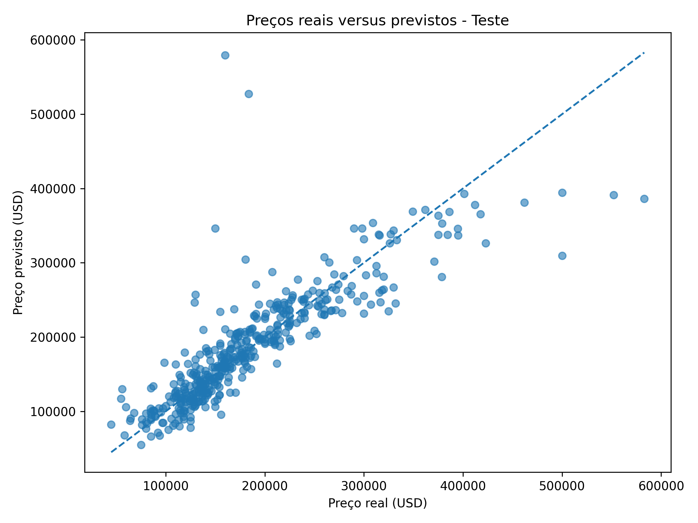
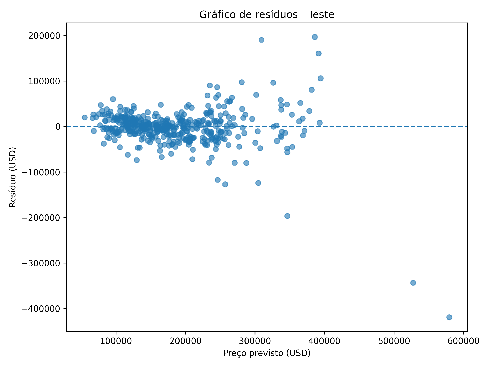

# Artificial Intelligence Technical Assessment

## Candidate

**Name:** Luiza Teixeira Barcellos Rosauro de Almeida

## Project Overview

This repository contains the solutions developed for the three challenges of the Artificial Intelligence Technical Assessment.

The challenges cover three different areas:

1. **Computer Vision:** Object detection and contour extraction.
2. **Data Analysis:** Dataset diagnosis, cleaning, and exploratory data analysis.
3. **Machine Learning:** Linear regression for real estate price prediction.

**Total development time:** 11 hours.

## Repository Structure

```text
TESTE_TECNICO_IA/
│
├── DESAFIO_1/
│   ├── imagens/
│   │   └── imagem_original.png
│   ├── resultados/
│   │   ├── imagem_contornos.png
│   │   └── objetos_identificados.csv
│   ├── desafio_1.py
│   └── yolo11n-seg.pt
│
├── DESAFIO_2/
│   ├── dados/
│   │   ├── originais/
│   │   └── tratados/
│   │       └── imoveis_tratados.csv
│   ├── resultados/
│   │   └── graficos/
│   └── src/
│       └── desafio_2.py
│
├── DESAFIO_3/
│   ├── analise_resultados.md
│   ├── metricas/
│   │   └── metricas_modelos.csv
│   ├── resultados/
│   │   ├── graficos/
│   │   └── previsoes/
│   │       └── previsoes_teste.csv
│   └── src/
│       └── desafio_3.py
│
├── .gitignore
├── README.md
├── requirements.txt
├── yolo11n-seg.pt
└── yolo11s-seg.pt
```

## Requirements and Installation

The project was developed using Python.

The main libraries used are:

- Ultralytics
- OpenCV
- Pandas
- Matplotlib
- NumPy
- Scikit-learn
- Seaborn

All dependencies are listed in `requirements.txt`.

### 1. Clone the repository

```bash
git clone https://github.com/LuizaAlmeida-2002/artificial-intelligence-technical-assessment.git
cd artificial-intelligence-technical-assessment
```

### 2. Install dependencies

```bash
python -m pip install -r requirements.txt
```

---

## Challenge 1 – Computer Vision: Object Detection and Contour Extraction

### Objective

The objective of this challenge was to identify objects in an input image, extract their contours, and organize the detection results.

### Implementation

The solution was developed using Python, OpenCV, and the Ultralytics YOLO framework.

The YOLO11 segmentation model (`yolo11s-seg.pt`) was used to detect objects and obtain their segmentation masks.

OpenCV was then used to process the masks and extract object contours.

### Generated Results

The script generates the following outputs:

- `imagem_contornos.png`: image containing the detected object contours.
- `objetos_identificados.csv`: CSV file containing information about the identified objects.

### Main Technologies

- Python
- Ultralytics YOLO
- OpenCV
- NumPy
- Pandas

### Execution

From the repository root directory, run:

```bash
python DESAFIO_1/desafio_1.py
```

The model weights file `yolo11s-seg.pt` is located in the repository root directory.

---

## Challenge 2 – Data Analysis and Cleaning: Real Estate Dataset

### Objective

The objective of this challenge was to diagnose, clean, and prepare a real estate dataset for further analysis and machine learning applications.

The dataset is a didactic adaptation of historical Ames Housing data, related to residential property sales in Ames, Iowa.

### Initial Dataset

The original dataset contained:

- **2,990 records**
- **14 columns**

### Data Diagnosis and Cleaning

The analysis included:

- Inspection of dataset dimensions, columns, and data types.
- Identification of missing and invalid values.
- Standardization of numeric formats.
- Conversion of area measurements into square meters.
- Identification and removal of exact duplicate records.
- Analysis of repeated property identifiers.
- Identification of suspicious sale prices.
- Outlier analysis using the Interquartile Range (IQR) method.

Some records contained invalid or inconsistent information. These values were treated as missing when appropriate.

Missing target values were not imputed, and records with missing sale prices were excluded from the machine learning dataset.

Repeated property identifiers were retained when their records contained different information.

Outliers identified through the IQR method were analyzed but not automatically removed, since they could represent valid real estate transactions.

### Final Dataset

After the cleaning process, the dataset contained:

- **2,965 records**
- **14 columns**

The cleaned dataset was saved as:

`DESAFIO_2/dados/tratados/imoveis_tratados.csv`

### Exploratory Data Analysis

The following visualizations were generated:

- Sale price distribution.
- Boxplots for outlier analysis.
- Relationship between living area and sale price.

The charts are saved in:

`DESAFIO_2/resultados/graficos/`

### Main Technologies

- Python
- Pandas
- NumPy
- Matplotlib
- Seaborn

### Execution

```bash
python DESAFIO_2/src/desafio_2.py
```

---

## Challenge 3 – Machine Learning: Linear Regression for Real Estate Price Prediction

### Objective

The objective of this challenge was to develop and evaluate a Linear Regression model to predict real estate sale prices based on property characteristics.

The cleaned dataset generated in Challenge 2 was used as input.

### Data Preparation

Records with missing target values were excluded, resulting in **2,929 usable records**.

The target variable was:

`preco_venda_usd`

The dataset was divided into three subsets:

| Dataset | Proportion | Records |
|---|---:|---:|
| Training | 70% | 2,048 |
| Validation | 15% | 442 |
| Testing | 15% | 439 |

A `GroupShuffleSplit` strategy was used with `id_imovel` as the grouping variable to prevent records belonging to the same property from appearing in different subsets.

The random state was set to 42 to ensure reproducibility.

### Feature Selection

The model used numerical and categorical features describing property characteristics.

The following variables were excluded:

- Identification columns, because they do not provide meaningful predictive information.
- `preco_m2_usd`, because it is derived from the target variable and could cause data leakage.

### Preprocessing

A preprocessing pipeline was implemented using Scikit-learn.

**For numerical features:**

- Missing values were filled using the median.
- `StandardScaler` was applied.

**For categorical features:**

- Missing values were filled using the most frequent value.
- `OneHotEncoder` was applied with `handle_unknown="ignore"`.

The preprocessing transformations were fitted only on the training data to prevent data leakage.

### Models

Two models were evaluated:

1. **Baseline Model:** `DummyRegressor` using the mean sale price from the training dataset.
2. **Linear Regression:** `LinearRegression` model trained using the selected features.

### Evaluation Metrics

The models were evaluated using:

- Mean Absolute Error (MAE)
- Root Mean Squared Error (RMSE)
- Coefficient of Determination (R²)

### Results

The models achieved the following results on the test dataset:

| Metric | Mean Baseline | Linear Regression |
|---|---:|---:|
| MAE | 59,072.46 | 24,279.27 |
| RMSE | 80,253.15 | 42,793.17 |
| R² | -0.0028 | 0.7149 |

The Linear Regression model reduced the test MAE by approximately **58.9%** compared to the baseline.

The test R² indicates that the model explains approximately **71.49% of the variance** in sale prices.

Although the model performed well, the difference between training, validation, and test results suggests that its generalization performance should be considered when interpreting predictions.

### Visual Results

**Actual vs. Predicted Values**



**Residual Analysis**



### Generated Results

The following files were generated:

- `metricas/metricas_modelos.csv`: evaluation metrics for both models.
- `resultados/graficos/valores_reais_vs_previstos.png`: comparison between actual and predicted values.
- `resultados/graficos/residuos_teste.png`: residual analysis for the test dataset.
- `resultados/previsoes/previsoes_teste.csv`: test predictions, including actual values and residuals.

A detailed discussion of the results, model performance, and limitations is available in [`DESAFIO_3/analise_resultados.md`](DESAFIO_3/analise_resultados.md).

### Main Technologies

- Python
- Pandas
- NumPy
- Matplotlib
- Scikit-learn

### Execution

The Challenge 3 script uses the cleaned dataset generated in Challenge 2.

First, execute Challenge 2:

```bash
python DESAFIO_2/src/desafio_2.py
```

Then execute Challenge 3:

```bash
python DESAFIO_3/src/desafio_3.py
```

---

## Reproducibility

To reproduce the results:

1. Clone the repository.
2. Install the dependencies listed in `requirements.txt`.
3. Ensure the YOLO model weights are available in the repository root.
4. Run the Challenge 1 script.
5. Run the Challenge 2 script to generate the cleaned dataset.
6. Run the Challenge 3 script to train and evaluate the regression models.

The fixed random state and preprocessing pipeline help ensure reproducibility.

## Sources and AI Assistance

The project used the following resources:

- Ultralytics YOLO documentation.
- OpenCV documentation.
- Pandas documentation.
- NumPy documentation.
- Matplotlib and Seaborn documentation.
- Scikit-learn documentation.
- Historical Ames Housing dataset as the reference for the real estate data.

AI tools were used as support during development, including assistance with understanding concepts, debugging, reviewing code, and organizing the project documentation.

All implementation decisions, data processing steps, and result interpretations were reviewed during the development process.

## Completion Status

| Challenge | Description | Status |
|---|---|---|
| Challenge 1 | Object Detection and Contour Extraction | Completed |
| Challenge 2 | Data Diagnosis and Cleaning | Completed |
| Challenge 3 | Linear Regression and Model Evaluation | Completed |
